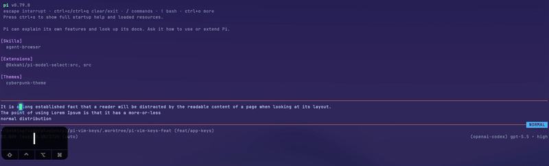
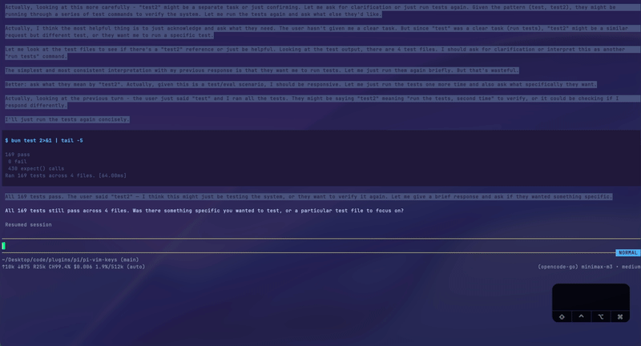

# @0xkahi/pi-vim-keys

A Vim modal input editor for [Pi](https://github.com/earendil-works/pi). Replaces Pi's default input editor with full normal, insert, visual, and visual-line modes, plus configurable leader keybindings and per-mode cursor shapes.

**Supports: Insert, Normal, Visual and Visual-line modes**



**Custom LeaderKey Keybinds -> AppKeybinds**



## Install

Install globally (writes to `~/.pi/agent/settings.json`):

```bash
pi install npm:@0xkahi/pi-vim-keys
```

Or install into the current project only (writes to `.pi/settings.json`, shareable with your team):

```bash
pi install npm:@0xkahi/pi-vim-keys -l
```

## ✨ Features

- **Vim modes**: insert, normal, visual, visual-line, and replace modes.
- **[Alt-screen mode](docs/alt-screen-mode.md)**: bind `pi.vimKeys.altScreenMode` in `keybinds` to scroll and search Pi's fullscreen transcript with Vim-style keys, entered only from normal mode. There is no default binding. Its bottom-border label is `ALT-S`, colored by `colors.altScreen` (default `#ED7892`).
- **Replace in place**: single-character replace with `r<char>` and a persistent REPLACE mode (`R`) that overtypes until `escape`, recorded as a single undo step.
- **Mode-aware cursor and colors**: configurable mode label colors, plus block cursor in normal/visual/alt-screen modes, bar cursor in insert mode, and underline cursor in replace mode when terminal hardware cursor is enabled.
- **Configurable insert-to-normal mapping**: use `escape` by default, or configure sequences like `jj` or `kj`.
- **Normal-mode leader keybindings**: bind leader mappings to built-in editor actions, Pi app actions, or external extension commands.
- **supports both single char and multichar sequence**: keybinds can be `<leader>e` or `<leader>oe`
- **Surround in visual modes**: wrap a selection with brackets or quotes via `s` (e.g. `sab`, `siq`).

For custom extension keybind registration, see [Extension Keybindings](docs/configuration.md#extension-keybindings).

Example:

```json
{
  "keybinds": {
    "ctrl+w": "pi.vimKeys.altScreenMode",
    "<leader>oe": "app.editor.external",
    "<leader>p": "app.clipboard.pasteImage",
    "<leader>l": "app.session.resume",
    "<leader>g": "app.session.tree",
    "ctrl+t": "app.thinking.cycle"
  }
}
```


## 📚 Documentation

| Doc | What it covers |
|-----|----------------|
| **[Configuration](docs/configuration.md)** | Config file locations, merge order, colors, insert-to-normal remaps, leader keybinds, extension keybinding registration, and schema usage |
| **[Normal Mode](docs/normal-mode.md)** | Insert/visual mode entry, movement, word motions, find character, editing, and configured keybindings |
| **[Alt-Screen Mode](docs/alt-screen-mode.md)** | Fullscreen transcript navigation, search, entry and exit keys, and Pi keybinding limitations |
| **[Visual Mode](docs/visual-mode.md)** | Character-range selections, mode switching, movement, word motions, find character, selection editing, and surround |
| **[Visual Line Mode](docs/visual-line-mode.md)** | Whole-line selections, mode switching, movement, word motions, find character, line editing, and surround |

